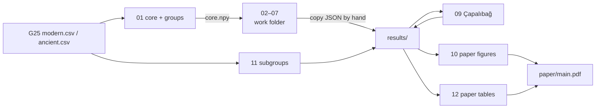

# Reproducing

## What you need

- Python with `numpy` and `scipy`. The commands below use `uv run --with numpy --with scipy`; there is no
  `requirements.txt` or `pyproject.toml`.
- The G25 `modern.csv` and `ancient.csv` (see [data.md](data.md)). Set `G25_DIR` to their folder.
- For `01_core_and_groups.py`: Hanami DNA's `V3__groups_presets_and_panel.sql` at the path hard-coded in
  that script.
- For the paper: a TeX Live with `latexmk`, `pdflatex`, BibTeX and the IEEEtran class.

> [!WARNING]
> `analysis/g25.py` builds file paths as `G25_DIR + "modern.csv"`, so `G25_DIR` must end with `/`.
> Without `G25_DIR` it falls back to a local path inside the Hanami DNA backend.

> [!NOTE]
> `01_core_and_groups.py` stops if the SQL file is missing, and every later script needs the `core.npy` it
> writes. Without the Hanami DNA backend the pipeline does not run as committed.

## Pipeline



## Commands

Run from the repo root.

### 1. Work-folder scripts

Scripts `01` to `07` take a work folder as their only argument and write there, not into `results/`.
Put your own `owner.npy` in the folder if you have one.

```bash
export G25_DIR=/path/to/g25/
W=$(mktemp -d)
for s in 01_core_and_groups 02_models 03_pre_turkic_split 04_clusters 05_kurdish_subgroups 06_closeness 07_pca; do
  uv run --with numpy --with scipy python analysis/$s.py "$W"
done
```

| Script | Writes to `$W` |
| --- | --- |
| `01_core_and_groups.py` | `core.npy`, `core_to_groups.json` |
| `02_models.py` | `models.json` |
| `03_pre_turkic_split.py` | nothing (prints the six source sets) |
| `04_clusters.py` | `clusters.json` |
| `05_kurdish_subgroups.py` | nothing (prints every Kurdish row against core, Azerbaijani and eastern Turks) |
| `06_closeness.py` | `closeness.json` |
| `07_pca.py` | `pca.json` (with the author's point if `owner.npy` is there) |

### 2. Copy into `results/`

No script copies these; do it by hand. `results/pca.json` is committed without the author's point, so
build it from a work folder without `owner.npy`.

```bash
cp "$W"/{core_to_groups,models,clusters,closeness,pca}.json results/
```

### 3. Scripts that read and write `results/`

These take no work-folder argument (except `10` and `08`).

```bash
uv run --with numpy --with scipy python analysis/09_capalibag.py         # reads results/clusters.json -> results/capalibag.json
uv run --with numpy --with scipy python analysis/11_subgroups.py         # -> results/subgroups.json
uv run python analysis/10_paper_figures.py "$W"                          # -> paper/figures/{regions,closeness,pca}.tex
uv run python analysis/12_paper_tables.py                                # -> paper/tables/{regions,subgroups}.tex
uv run --with numpy --with scipy python analysis/08_emit_site_data.py "$W" turkic-data.ts   # the website's data file
```

`10_paper_figures.py` reads `pca.json` from the folder you pass (default `results/`), so passing a work
folder with `owner.npy` puts the author's point in the paper's PCA figure. `08_emit_site_data.py` also
imports `g25.py`, so it needs `G25_DIR` and `numpy`.

### 4. Build the paper

```bash
cd paper
make pdf        # latexmk (pdflatex) into build/, copies build/main.pdf to main.pdf
make clean      # removes build/
make distclean  # also removes main.pdf
```

BibTeX finds `../bibliography.bib` through `BIBINPUTS`. `figures/timeline.tex` and `figures/periods.tex`
are drawn by hand; the other figures and both tables are generated by steps 3 above.
